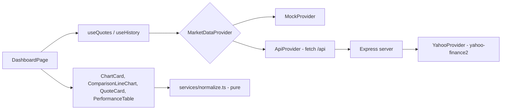

# Architecture

## Data flow



`src/services/index.ts` picks the provider: `MockProvider` by default, `ApiProvider` when `VITE_DATA_SOURCE=api`.

## Rules

1. Components never call `fetch` or import `yahoo-finance2`. Only hooks talk to a `MarketDataProvider`.
2. A new data source implements `MarketDataProvider` in `shared/MarketDataProvider.ts`.
3. Derived numbers (percent change, rebasing, ranking) live in `src/services/normalize.ts` as pure functions with unit tests.
4. Time windows map to Yahoo queries in one place: `server/windows.ts`.
5. Companies are configured only in `src/config/companies.ts` (IBM + at most four).
6. Errors are `MarketDataError` with an `ApiErrorCode`. The server maps codes to HTTP status; the UI shows the message.
7. One failing symbol must not blank the dashboard (`useHistory` settles per symbol).
8. Tests and CI use `MockProvider` or an injected fake. CI never calls Yahoo.
9. Yahoo response handling lives in `server/providers/yahooMapping.ts` as pure functions, so it can be unit tested without the network. `YahooProvider` only performs the calls.
10. Never fabricate data. A quote with a missing price, change or percent is dropped (the UI names the missing symbol). A missing close stays `null` in the series.
11. History is regular trading hours only, and the `1d` session is chosen by the exchange's timezone (`meta.exchangeTimezoneName`), not UTC.
12. The company limit is `MAX_COMPANIES` in `shared/types.ts`, used by both the client config and the API.

## Extension points

| To add | Touch |
|---|---|
| A company | `src/config/companies.ts` |
| A time window | `shared/types.ts`, `server/windows.ts`, `src/services/mockProvider.ts`, `src/components/layout/WindowTabs.tsx` |
| A chart | New component under `src/components/charts/`, wrapped in `ChartCard` |
| A data source | New class implementing `MarketDataProvider` |
| Another per-symbol view | Same pattern as the user-selected company graph: a component that validates input with `normalizeSymbol`, state in `DashboardPage`, another `useHistory` call, and a `ChartCard` + `ComparisonLineChart`. |

## Validation before every PR

```bash
cd finance-app
npm run lint && npm run typecheck && npm test && npm run build
```

Link the issue in the PR (`Closes #N`) and tick the acceptance criteria in the PR template.

## User-selected company graph

`SymbolPicker` (`src/components/layout/`) validates input with `normalizeSymbol` before reporting anything, so malformed tickers never reach the data layer. `DashboardPage` holds the chosen symbol and calls `useHistory(provider, window, [symbol])`, which returns nothing and makes no requests while no symbol is selected. The card follows the active time window. Because `useHistory` keeps the previous symbol's data for one render after the symbol changes, the page keeps only series that match the current symbol; `DashboardPage.test.tsx` has a test that fails if that filter is removed.

## Time window in the URL

The active window lives in the `?window=1d|7d|3m` query parameter, read and written by `useUrlWindow` (`src/hooks/`). A missing or unknown value falls back to `1d`. Tab clicks use `history.replaceState`, so the page does not reload, the back button is not filled with tab switches, and other query parameters and the hash are preserved. The hook reads the URL once on mount; it does not listen for `popstate`, which is fine while nothing else pushes history entries. `src/test/setup.ts` resets the URL after each test so URL state cannot leak between tests.
