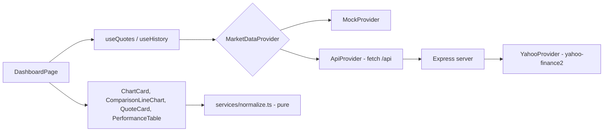

# Architecture

## Data flow



`src/services/index.ts` picks the provider: `MockProvider` by default, `ApiProvider` when `VITE_DATA_SOURCE=api`.

## Rules

1. Components never call `fetch` or import `yahoo-finance2`. Only hooks talk to a `MarketDataProvider`.
2. A new data source implements `MarketDataProvider` in `shared/MarketDataProvider.ts`.
3. Derived numbers (percent change, rebasing, ranking) live in `src/services/normalize.ts` as pure functions with unit tests.
4. Time windows map to Yahoo queries in one place: `server/windows.ts`.
5. Companies are configured only in `src/config/companies.ts` (IBM + at most four).
6. Errors are `MarketDataError` with an `ApiErrorCode`. The server maps codes to HTTP status; the UI shows the message.
7. One failing symbol must not blank the dashboard (`useHistory` settles per symbol).
8. Tests and CI use `MockProvider` or an injected fake. CI never calls Yahoo.
9. Yahoo response handling lives in `server/providers/yahooMapping.ts` as pure functions, so it can be unit tested without the network. `YahooProvider` only performs the calls.
10. Never fabricate data. A quote with a missing price, change or percent is dropped (the UI names the missing symbol). A missing close stays `null` in the series.
11. History is regular trading hours only, and the `1d` session is chosen by the exchange's timezone (`meta.exchangeTimezoneName`), not UTC.
12. The company limit is `MAX_COMPANIES` in `shared/types.ts`, used by both the client config and the API.

## Extension points

| To add | Touch |
|---|---|
| A company | `src/config/companies.ts` |
| A time window | `shared/types.ts`, `server/windows.ts`, `src/services/mockProvider.ts`, `src/components/layout/WindowTabs.tsx` |
| A chart | New component under `src/components/charts/`, wrapped in `ChartCard` |
| A data source | New class implementing `MarketDataProvider` |
| User-selected company graph (Part 2) | New `SymbolPicker` component, selected-symbol state in `DashboardPage`, a second `useHistory` call, a `ChartCard` + `ComparisonLineChart`. Reuse `normalizeSymbol` for validation. |

## Validation before every PR

```bash
cd finance-app
npm run lint && npm run typecheck && npm test && npm run build
```

Link the issue in the PR (`Closes #N`) and tick the acceptance criteria in the PR template.
